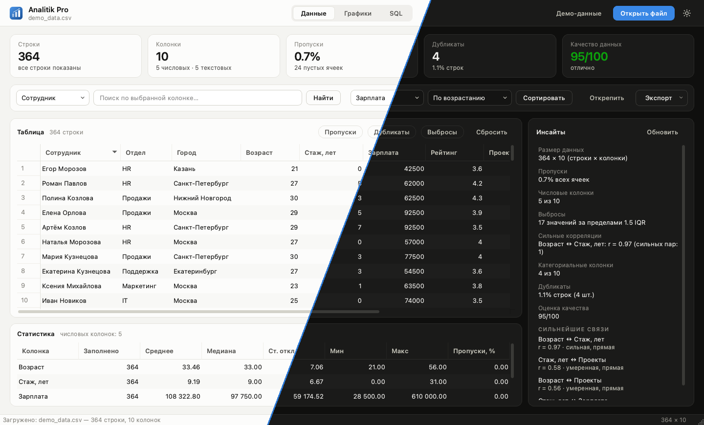
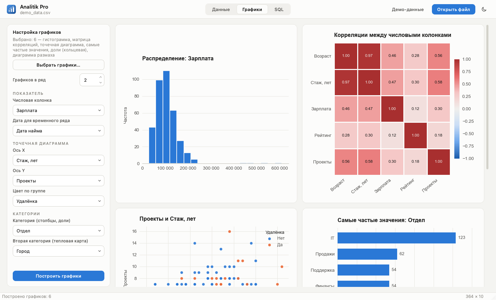
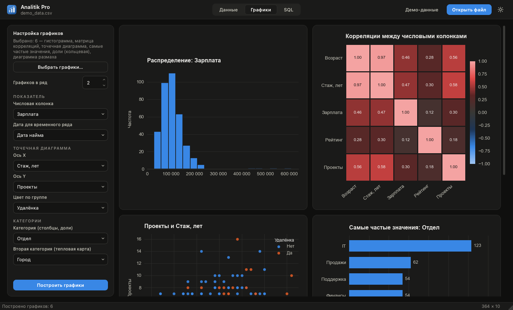
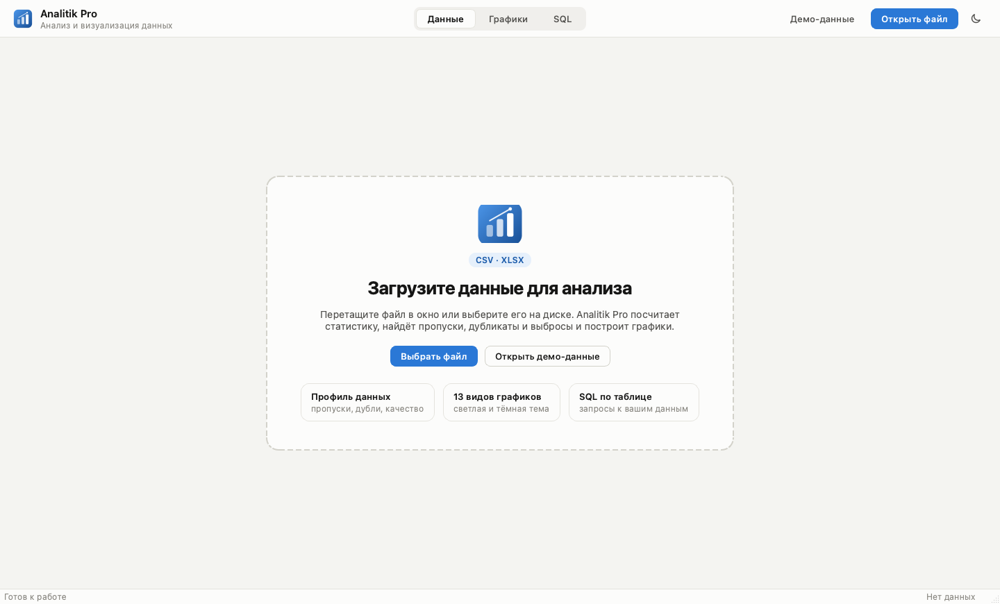
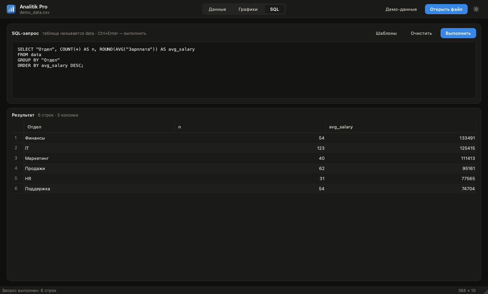

<div align="center">


# Analitik Pro

**Настольное приложение для быстрого анализа и визуализации табличных данных**

Откройте CSV или Excel, и за пару секунд получите профиль данных, оценку качества, автоматические инсайты, 13 видов графиков и SQL-консоль.




</div>

---

## Возможности

| | |
|---|---|
| 📥 **Загрузка** | CSV и Excel, перетаскиванием в окно или через диалог. Кодировка CSV подбирается автоматически (UTF-8 → CP1251 → Latin-1). Встроенный демо-набор на 364 строки. |
| 📊 **Профиль данных** | Карточки с ключевыми цифрами: строки, колонки, доля пропусков, дубликаты и **оценка качества** от 0 до 100. Статистика по числовым колонкам: среднее, медиана, разброс, минимум, максимум. |
| 💡 **Инсайты** | Выбросы по правилу 1,5 IQR, сильнейшие корреляции, колонки-идентификаторы, константы и дубликаты. Пересчитываются по текущей выборке. |
| 🔎 **Фильтры** | Поиск по колонке, сортировка, быстрые фильтры «Пропуски», «Дубликаты», «Выбросы». Ячейки редактируются прямо в таблице, строки и колонки удаляются из контекстного меню. |
| 📈 **13 видов графиков** | Гистограмма, плотность (KDE), диаграмма размаха, выбросы, сравнение распределений, матрица корреляций, точечная и тепловая карта, частые значения, доли, линия, временной ряд, карта пропусков. Колонки по умолчанию подбираются автоматически. |
| 🗄 **SQL** | Запросы к загруженной таблице (`data`) во встроенной SQLite. Есть шаблоны, в том числе под ваши колонки. `Ctrl+Enter` запускает запрос. |
| 💾 **Экспорт** | Данные в CSV/Excel, отчёт в папку (сводка, пропуски, топ значений, текстовый профиль), графики в PNG. |
| 🌗 **Две темы** | Светлая и тёмная, по умолчанию берётся системная. Графики перерисовываются в цветах темы. |

## Скриншоты

<table>
  <tr>
    <td width="50%"><br><sub><b>Графики</b>: колонки подбираются автоматически</sub></td>
    <td width="50%"><br><sub>Те же графики в <b>тёмной теме</b></sub></td>
  </tr>
  <tr>
    <td><br><sub><b>Старт</b>: перетащите файл или откройте демо</sub></td>
    <td><br><sub><b>SQL</b> прямо по загруженной таблице</sub></td>
  </tr>
</table>

## Быстрый старт

Нужен **Python 3.10+**.

**В один клик.** Запустите `Запустить.command` (macOS/Linux) или `Запустить.bat` (Windows). При первом запуске скрипт сам создаст виртуальное окружение и установит зависимости.

**Вручную:**

```bash
git clone https://github.com/Sena22555/analitik-pro.git
cd analitik-pro
python3 -m venv .venv
source .venv/bin/activate        # Windows: .venv\Scripts\activate
pip install -r requirements.txt
python app.py
```

Нажмите **«Демо-данные»**, чтобы сразу посмотреть приложение на примере: 364 сотрудника, их отделы, города, зарплаты и рейтинги. В набор специально заложены пропуски, дубликаты и выбросы.

## Сборка приложения

```bash
pip install pyinstaller
pyinstaller AnalitikApp.spec
```

Результат: `dist/Analitik Pro.app` на macOS или `dist/Analitik Pro/` на Windows. Иконка, ресурсы и демо-данные уже включены.

## Горячие клавиши

| Клавиши | Действие |
|---|---|
| `Ctrl+O` | Открыть файл |
| `Ctrl+S` | Сохранить данные |
| `Ctrl+1` / `2` / `3` | Вкладки «Данные», «Графики», «SQL» |
| `Ctrl+I` | Обновить сводку |
| `Ctrl+G` | Построить графики |
| `Ctrl+Enter` | Выполнить SQL |
| `F11` | Полноэкранный режим |

## Как устроено

```
analitik-pro/
├── app.py            # интерфейс: окно, вкладки, таблицы, фоновые задачи
├── analytics.py      # ядро: загрузка, статистика, инсайты, графики
├── styles.py         # дизайн-система: цветовые токены и стили для обеих тем
├── assets/           # иконка приложения и значки интерфейса (SVG)
├── demo_data.csv     # демо-набор
└── AnalitikApp.spec  # конфигурация сборки PyInstaller
```

- **Интерфейс не зависает.** Загрузка файлов, построение графиков и SQL-запросы выполняются в фоновых потоках (`QThread`). Графики строятся на `matplotlib.Figure` без `pyplot`, поэтому это безопасно.
- **Единая дизайн-система.** Все цвета заданы токенами в `styles.py`, а таблица стилей Qt собирается из одного шаблона, поэтому светлая и тёмная темы всегда согласованы.
- **Палитра графиков проверена на доступность.** Соседние цвета различимы при самых частых нарушениях цветового зрения, протанопии и дейтеранопии (ΔE ≥ 8). Для каждой темы подобраны свои оттенки. Корреляции показаны расходящейся шкалой с нейтральной серединой, тепловые карты — одноцветной.
- **Совместимость с pandas 3.** Текстовые колонки определяются одинаково и в pandas 2, и в pandas 3, где у строк появился новый тип `str`.

## Стек

**Python** · **PySide6 (Qt 6)** · **pandas** · **NumPy** · **matplotlib** · **SQLite** · **openpyxl** · **PyInstaller**

---

<div align="center">
<sub>Автор: <a href="https://github.com/Sena22555">Arsenij Sadovskij</a></sub>
</div>
